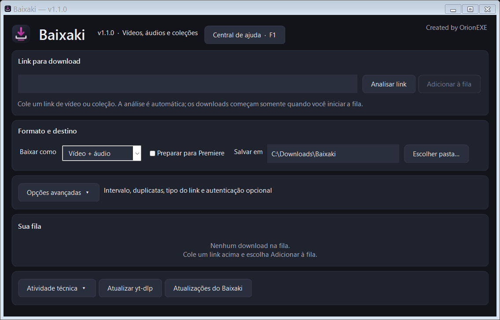
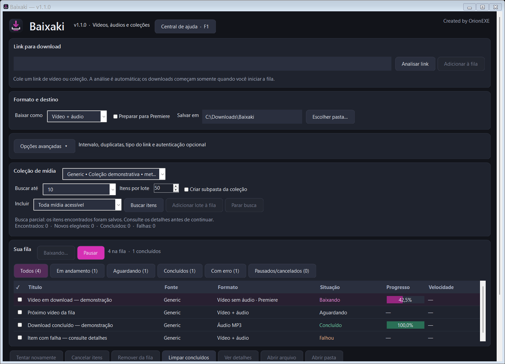

# Baixaki

**Gerenciador de downloads para Windows com yt-dlp e FFmpeg.**

O Baixaki reúne downloads individuais e coleções em uma interface nativa, com tema escuro e identidade magenta. A versão **1.1.0** adiciona fila persistente, descoberta de coleções, lotes manuais e recuperação de downloads interrompidos.

A mesma interface é usada para todas as fontes. Os sites e recursos disponíveis dependem do [yt-dlp instalado](https://github.com/yt-dlp/yt-dlp), dos extratores e das condições de acesso de cada serviço.



*Interface com dados demonstrativos; nenhuma conta ou perfil real foi usado.*

## Interface em português

Cartões organizam o link, o formato, o destino, a coleção e a fila. O texto principal usa 11 pt; os títulos e campos de link são maiores. A janela ajusta a altura inicial ao conteúdo e ao espaço disponível na tela, sem reservar uma grande área vazia no rodapé.

O botão principal muda entre **Adicionar à fila** e **Abrir coleção** conforme o link. Os estados dos downloads aparecem em português. **Opções avançadas** reúne intervalo, duplicatas, tipo manual do link e cookies; **Atividade técnica** mostra os detalhes do motor quando necessário. Um duplo clique no item ou **Ver detalhes** abre o destino, arquivo e erro completo. A fila oferece filtros com contadores — **Em andamento**, **Aguardando**, **Concluídos**, **Com erro** e **Pausados/cancelados** —, barras de progresso e botões **Abrir arquivo** e **Abrir pasta**.



## Limitação confirmada: perfis do Instagram

O yt-dlp 2026.10.21 distribuído com esta compilação lista `instagram:user` como **CURRENTLY BROKEN**. Não anuncie download de perfis/abas de reels do Instagram como funcionalidade disponível nesta versão. Um link de reel individual e uma página de perfil usam capacidades diferentes.

Se o motor retornar URL não suportada ou extrator quebrado, o Baixaki explica a limitação e não apresenta isso como um pedido de login. Ativar cookies ou forçar a seleção manual de coleção não repara esse extrator. As simulações com identidade “Instagram” validam a fila universal, não o acesso real a perfis do serviço.

## Recursos

- **Vídeo + áudio**, **somente vídeo sem áudio** ou **somente áudio em MP3** em um seletor exclusivo.
- Conversão opcional para Premiere em downloads de vídeo, com H.264, AAC quando aplicável e pixels `yuv420p`. O modo somente vídeo continua sem áudio após a conversão.
- Fila sequencial com inclusão de itens durante os downloads, pausa, retomada, cancelamento, remoção e novas tentativas.
- Estado da fila, coleções, preferências e histórico preservados entre sessões.
- Análise de URLs por metadados do yt-dlp, com seleção manual para casos ambíguos.
- **Central de ajuda integrada**, acessível em **Central de ajuda (F1)**, com 12 tópicos e avisos para operações delicadas.
- Um **Coleção de mídia** para playlists, canais, perfis e outras coleções que o extrator conseguir enumerar.
- **Smart Batch Mode**: 50 itens elegíveis por lote, por padrão, e continuação manual.
- **Smart Download**: intervalo configurável, prevenção de duplicatas, arquivo de downloads e tentativas limitadas para falhas transitórias.
- Bloqueio de novas solicitações à fonte quando há indicação clara de limite de acesso ou desafio de autenticação.
- Cookies opcionais de um navegador compatível, selecionados apenas para a sessão.
- Pasta de destino personalizável, detecção de link na área de transferência e registro de atividade.
- Atualização do yt-dlp e verificação de atualizações do aplicativo pelo GitHub.

## Instalação

Na [página de releases](https://github.com/TheOrionEXE/Baixaki/releases), baixe o instalador da versão publicada e execute `BaixakiSetup.exe`.

O instalador inclui o aplicativo, o yt-dlp, o FFmpeg, o ícone e os avisos de licença dos componentes distribuídos. Não é necessário instalar Python ou Node.js para usar o aplicativo.

Para uma distribuição portátil, mantenha `Baixaki.exe`, `yt-dlp.exe` e `ffmpeg.exe` na mesma pasta.

**Ambiente de referência:** Windows 10/11 de 64 bits, com .NET Framework 4.5 ou superior. Os motores incluídos também precisam ser compatíveis com o Windows utilizado.

## Como usar

1. Cole a URL de uma página de mídia ou coleção. O Baixaki fará a análise automaticamente.
2. Escolha o modo, a pasta de destino e, se desejar, a conversão para Premiere.
3. Para um item individual, clique em **Adicionar à fila**.
4. Para uma coleção, o painel abre com uma prévia limitada. A descoberta ampliada é manual: revise o aviso, o limite inicial de 10 e o tamanho do lote; use **Buscar itens** e depois **Adicionar lote à fila** para adicionar as entradas descobertas à fila.
5. Clique em **Iniciar downloads / Retomar fila** para iniciar o processamento.

**Pausar** interrompe o processo ativo e conserva os arquivos necessários à retomada. A possibilidade de continuar os bytes já transferidos depende do formato e do servidor. **Cancelar itens** cancela os itens selecionados e limpa somente os temporários pertencentes à tarefa, preservando uma fonte já baixada para recuperação de conversão.

Se uma conversão falhar, **Tentar novamente** reaproveita a fonte local quando ela ainda existe. Arquivos finais apagados deixam de ser considerados downloads existentes nas novas inclusões.

## Coleções e lotes

A descoberta de entradas é separada do download. O limite inicial de descoberta é **10 entradas**, e a enumeração ampliada pede confirmação. Os limites disponíveis são 10, 50, 100, todos os disponíveis ou um número personalizado. Uma pasta específica da coleção é opcional; o modo e a conversão selecionados são aplicados aos novos itens do lote.

Os filtros de vídeo e de mídia compatível com áudio usam os metadados efetivamente retornados. Quando o extrator não informa o tipo, essas entradas não são classificadas por suposição; **Toda mídia acessível** permite encaminhá-las para a tentativa normal de download. Tipos que o pipeline de vídeo/MP3 não atende são identificados como não suportados.

- O padrão é um download por vez e 50 itens elegíveis por lote.
- O próximo lote depende de uma ação manual após o lote atual terminar ou ser cancelado.
- A descoberta salva entradas durante a enumeração e pode terminar parcialmente.
- Uma nova descoberta reconcilia os identificadores já conhecidos; não existe uma promessa de paginação ou retomada exata para todos os extratores.
- Totais desconhecidos permanecem desconhecidos. Entradas de mídia não equivalem necessariamente ao número de publicações de um perfil.
- Perfis grandes dependem do extrator, da autenticação e dos limites do serviço. A lógica foi testada com 2.005 entradas simuladas por extrator; isso não garante a enumeração de qualquer perfil real.

## Ajuda avançada e cuidado com perfis

Abra **Central de ajuda (F1)** no programa ou consulte o [guia avançado](GUIA-AVANCADO.md). Há instruções sobre coleções grandes, filtros, lotes, recuperação, conversão, cookies, limites e diagnóstico.

**Enumerar perfis pode causar bloqueios temporários e restrições na conta**, especialmente usando cookies. A espera entre solicitações não elimina esse risco. Comece com 10 entradas, sem autenticação quando possível, e confira os resultados antes de ampliar a operação. O limite de entradas não garante uma quantidade exata de requisições; o extrator pode precisar consultar mais páginas.

A descoberta ampliada exige confirmação; os lotes continuam manuais. Cookies são opcionais e começam desativados. Cancelar e remover tarefas também apresentam explicações breves antes de executar a ação.

## Restrições e autenticação

O intervalo padrão entre itens e entre solicitações de extração é de 5 segundos. Falhas reconhecidas como transitórias têm até duas novas tentativas, com espera conservadora. Limites de acesso e exigências claras de autenticação suspendem novas solicitações à fonte afetada.

Quando o motor informa `Retry-After`, o prazo é respeitado. Se não houver um prazo utilizável, a fonte permanece em espera até a liberação manual. Após resolver a causa, use **Revisar fontes em pausa** e tente novamente os itens bloqueados. Cabeçalhos não expostos pelo yt-dlp não podem ser interpretados pelo aplicativo.

O uso de cookies depende do suporte do yt-dlp e do acesso permitido pelo navegador. O aplicativo não exporta cookies nem grava seus valores na fila ou no histórico. A escolha de navegador é mantida somente na sessão. Use URLs de páginas sem credenciais ou tokens de autenticação embutidos; diagnósticos sensíveis são ocultados no registro.

## Estado e recuperação

O estado é salvo em `%APPDATA%\Baixaki\state.json`, com substituição atômica e uma cópia de segurança `state.json.bak`. A pasta anteriormente salva em `folder.txt` é aproveitada na primeira execução da nova versão.

Itens interrompidos retornam pausados. Retome a fila explicitamente após abrir o aplicativo. As pastas de trabalho ficam em `<destino>\.baixaki\<id-da-tarefa>`; não as apague enquanto precisar recuperar downloads ou conversões.

O histórico diferencia MP3, vídeo, vídeo sem áudio e saídas convertidas. A prevenção de duplicatas verifica se os arquivos de saída ainda existem. **Limpar concluídos** limpa a visualização da fila, preservando o histórico.

## Compilar

O projeto usa Windows Forms e o compilador C# do .NET Framework instalado no Windows. Não utiliza NuGet, Electron ou um serviço web para executar a interface.

```bat
build.bat
```

Para gerar o instalador com o fluxo interativo existente:

```bat
build-installer.bat
```

Para uma compilação automatizada da versão 1.1.0:

```powershell
powershell.exe -NoProfile -ExecutionPolicy Bypass -File .\build-installer.ps1 -Version 1.1.0 -NonInteractive -NoOpen
```

O instalador requer Inno Setup 6. O script reutiliza os motores locais quando presentes; quando faltam, tenta obtê-los conforme o fluxo de compilação. Caso o compilador Inno Setup esteja em outro local, informe `-IsccPath "C:\caminho\ISCC.exe"`.

A saída é `Output\BaixakiSetup.exe`. O script grava a versão do aplicativo e os metadados do executável antes da compilação.

## Testes

```powershell
powershell.exe -NoProfile -ExecutionPolicy Bypass -File .\test.ps1
```

Para incluir a integração com yt-dlp e FFmpeg reais em um servidor HTTP temporário de loopback:

```powershell
powershell.exe -NoProfile -ExecutionPolicy Bypass -File .\test.ps1 -Integration
```

Esses testes não acessam contas pessoais nem baixam conteúdo de redes sociais. A integração local pode exigir permissão de rede no ambiente em que for executada. O [relatório de implementação](IMPLEMENTATION-REPORT.md) descreve a validação realizada e seus limites.

## Atualizações

**Atualizar yt-dlp** atualiza o yt-dlp separadamente. Pausar a fila e aguarde o encerramento do processo ativo antes de atualizar o motor.

O aplicativo consulta as releases de `TheOrionEXE/Baixaki`. Para distribuir uma atualização, a tag deve corresponder à versão, por exemplo `v1.1.0`, e o instalador anexado deve manter o nome **BaixakiSetup.exe**. Compilar os arquivos não publica uma release automaticamente.

## Componentes e licenças

- [yt-dlp](https://github.com/yt-dlp/yt-dlp)
- [FFmpeg](https://ffmpeg.org/)
- [Inno Setup](https://jrsoftware.org/isinfo.php), usado para criar o instalador

Os avisos distribuídos com o FFmpeg estão na pasta `licenses`. A licença do código do Baixaki deve ser definida pelo mantenedor em um arquivo `LICENSE`; este README não atribui uma licença ao projeto.


O novo ícone é distribuído em assets/baixaki.ico. Para regenerá-lo a partir da geometria vetorial, execute build-icon.ps1; o processo usa somente System.Drawing e o compilador do Windows.


### Seleção na fila

Marque as caixas dos itens para aplicar ações em lote. O checkbox do cabeçalho marca ou desmarca os itens do filtro atual; as marcações permanecem ao trocar de filtro. Sem itens marcados, as ações usam as linhas selecionadas.

