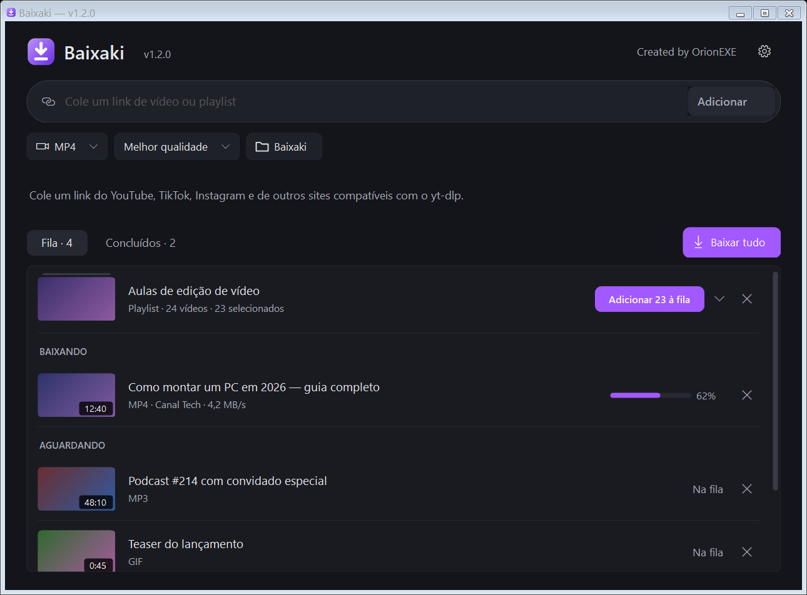
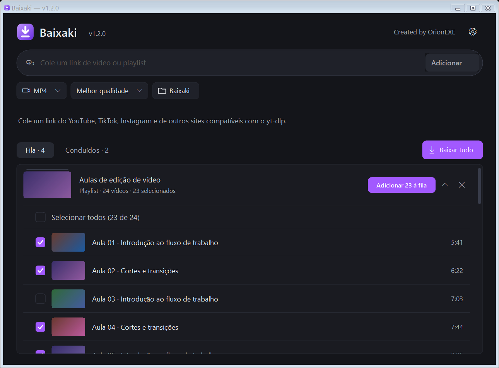
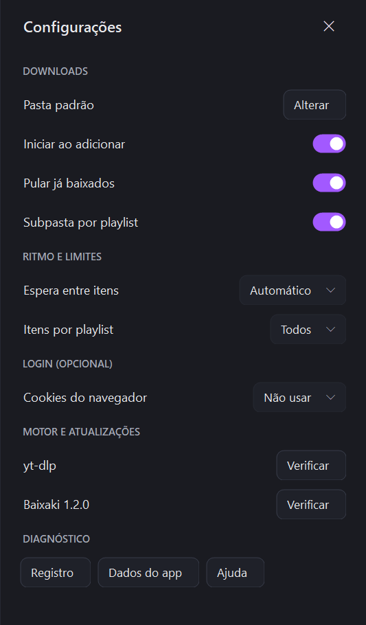

# Baixaki

**Gerenciador de downloads para Windows com yt-dlp e FFmpeg.**

O Baixaki baixa vídeos, áudios, GIFs e playlists em uma interface nativa, escura e enxuta. A série **1.2** traz uma interface totalmente nova: um campo único para colar o link, miniaturas em todos os vídeos, abas separadas para a **Fila** e os **Concluídos**, novos formatos (GIF, WAV, miniatura) e uma análise de links sem espera.

Os sites e recursos disponíveis dependem do [yt-dlp instalado](https://github.com/yt-dlp/yt-dlp), dos extratores e das condições de acesso de cada serviço.



*Interface com dados demonstrativos; nenhuma conta ou perfil real foi usado.*

## A interface

- **Um campo só.** Cole o link e pressione Enter. O Baixaki mostra a miniatura, o título, o canal e a duração enquanto identifica o link, e a análise não tem esperas artificiais.
- **Janela estável.** O tamanho da janela é fixo e nunca muda sozinho: abas, playlists e configurações aparecem dentro dela. A lista é desenhada sob medida para redimensionar sem travar, mesmo com centenas de vídeos.
- **Formato, qualidade e pasta à vista**, em etiquetas logo abaixo do campo. Todo o resto fica na engrenagem, no canto superior direito.
- **Fila e Concluídos separados.** A Fila mostra o que está baixando, aguardando ou com problema. Os Concluídos aparecem agrupados por dia, com busca, e saem da lista depois de 12 dias (os arquivos nunca são apagados).



### Playlists

Cole o link de uma playlist e escolha o que baixar: a linha da playlist abre uma lista com miniaturas, duração e caixas de seleção. Para playlists do YouTube a listagem é automática e o padrão é **Todos** os vídeos (também há 10 e 50). Fora do YouTube, o programa pede confirmação antes de listar. Perfis inteiros podem gerar bloqueios, veja o aviso abaixo.

### Formatos

| Formato | Para que serve |
|---|---|
| **MP4** | Vídeo + áudio, o padrão. Qualidade: melhor, 1080p, 720p ou 480p. |
| **Premiere** | H.264 em MP4, `yuv420p`, áudio AAC, para abrir bem em editores. |
| **GIF** | Um trecho do vídeo: início, duração (até 60 s) e largura. Só o trecho é baixado. |
| **MP3** | Apenas o áudio, compatível com tudo. |
| **WAV** | Áudio sem perda, para edição. |
| **Miniatura** | Só a imagem de capa, em JPG. |



### Configurações

Pasta padrão, iniciar ao adicionar, pular já baixados, subpasta por playlist, espera entre itens, itens por playlist, cookies do navegador, versões do yt-dlp e do Baixaki, registro técnico, pasta de dados e Central de ajuda. A **espera entre itens** é automática: 1 segundo para menos de 10 vídeos e 5 segundos a partir disso (também dá para fixar o valor). O **yt-dlp se atualiza sozinho**, no máximo uma vez por dia e só quando nada está baixando.

## Limitação confirmada: perfis do Instagram

O yt-dlp 2026.10.21 distribuído com esta compilação lista `instagram:user` como **CURRENTLY BROKEN**. Por isso, ao colar o link de um perfil do Instagram, o Baixaki avisa na hora, sem fazer nenhuma requisição, e sugere colar o link de um post ou reel. Links de posts e reels individuais continuam funcionando. Ativar cookies ou forçar a seleção manual não repara esse extrator.

## Recursos

- Fila sequencial com inclusão de itens durante os downloads, pausa, retomada, cancelamento, remoção e novas tentativas.
- Fila, playlists, preferências e histórico preservados entre sessões; downloads interrompidos voltam pausados.
- **Central de ajuda integrada** (F1 ou Configurações > Ajuda), com 12 tópicos e avisos para operações delicadas. O [guia avançado](GUIA-AVANCADO.md) traz o mesmo conteúdo.
- Prevenção de duplicatas e tentativas limitadas para falhas transitórias.
- Bloqueio de novas solicitações à fonte quando há indicação clara de limite de acesso ou desafio de autenticação.
- Cookies opcionais de um navegador compatível, usados apenas durante a sessão.
- Detecção de link na área de transferência.

## Instalação

Na [página de releases](https://github.com/TheOrionEXE/Baixaki/releases), baixe o instalador da versão publicada e execute `BaixakiSetup.exe`.

O instalador inclui o aplicativo, o yt-dlp, o FFmpeg, o ícone e os avisos de licença dos componentes distribuídos. Não é necessário instalar Python ou Node.js para usar o aplicativo.

Para uma distribuição portátil, mantenha `Baixaki.exe`, `yt-dlp.exe` e `ffmpeg.exe` na mesma pasta.

**Ambiente de referência:** Windows 10/11 de 64 bits, com .NET Framework 4.5 ou superior. Os motores incluídos também precisam ser compatíveis com o Windows utilizado.

## Como usar

1. Cole o link de um vídeo ou playlist no campo do topo e pressione **Enter** (ou clique em **Adicionar**).
2. Antes, se quiser, mude o formato, a qualidade ou a pasta nas etiquetas abaixo do campo.
3. Um vídeo individual entra na Fila e começa a baixar. Em uma playlist, marque os vídeos e clique em **Adicionar N à fila**.
4. Acompanhe na aba **Fila**. Quando terminar, o item passa para **Concluídos**, onde você abre o arquivo ou a pasta.

**Pausar** interrompe o processo ativo e conserva os arquivos necessários à retomada. A possibilidade de continuar os bytes já transferidos depende do formato e do servidor. O X de um item em andamento cancela e limpa só os temporários da tarefa. **Limpar fila**, ao lado de Baixar tudo, remove de uma vez tudo que ainda não terminou (com confirmação) e não apaga nenhum arquivo já baixado. Se uma conversão falhar, **Tentar de novo** reaproveita a fonte local quando ela ainda existe.

## Cuidado com perfis e coleções

**Listar perfis inteiros pode causar bloqueios temporários e restrições na conta**, especialmente usando cookies. A espera entre solicitações não elimina esse risco. Fora do YouTube, o programa pede confirmação antes de listar uma coleção. Comece com 10 itens, sem autenticação quando possível, e confira os resultados antes de ampliar a operação. O limite de itens não garante uma quantidade exata de requisições; o extrator pode consultar mais páginas.

Limites de acesso e exigências claras de autenticação suspendem novas solicitações à fonte afetada. Quando o motor informa `Retry-After`, o prazo é respeitado. Só linhas de erro do yt-dlp pausam uma fonte (avisos são ignorados). Sem prazo do servidor, a pausa termina sozinha em 20 minutos; o item parado mostra o motivo e você pode liberar antes em **Configurações > Diagnóstico > Fontes em pausa**, depois de resolver a causa. Falhas transitórias têm até duas novas tentativas, com espera conservadora.

O uso de cookies depende do suporte do yt-dlp e do acesso permitido pelo navegador. O aplicativo não exporta cookies nem grava seus valores na fila ou no histórico, e a escolha de navegador vale somente na sessão. Use links sem credenciais ou tokens embutidos; diagnósticos sensíveis são ocultados no registro.

## Estado e recuperação

O estado é salvo em `%APPDATA%\Baixaki\state.json`, com substituição atômica e uma cópia de segurança `state.json.bak`. As miniaturas ficam em um cache em `%APPDATA%\Baixaki\thumbs`, limpo automaticamente. As pastas de trabalho ficam em `<destino>\.baixaki\<id-da-tarefa>` (no endereço real da pasta, mesmo que ela seja uma junção ou esteja redirecionada); não as apague enquanto precisar recuperar downloads ou conversões. Se mesmo assim o Windows bloquear o yt-dlp nesse caminho (erro 448), o Baixaki avisa e sugere escolher uma pasta comum, como Vídeos, que é a pasta padrão em instalações novas.

O histórico diferencia MP4, Premiere, GIF, MP3, WAV e miniatura, e também a qualidade escolhida. A prevenção de duplicatas verifica se os arquivos de saída ainda existem. As linhas de Concluídos saem da lista após 12 dias; isso não apaga nenhum arquivo.

## Compilar

O projeto usa Windows Forms e o compilador C# do .NET Framework instalado no Windows. Não utiliza NuGet, Electron ou um serviço web para executar a interface.

```bat
build.bat
```

Para gerar o instalador com o fluxo interativo existente:

```bat
build-installer.bat
```

Para uma compilação automatizada da versão 1.2.3:

```powershell
powershell.exe -NoProfile -ExecutionPolicy Bypass -File .\build-installer.ps1 -Version 1.2.3 -NonInteractive -NoOpen
```

O instalador requer Inno Setup 6. O script reutiliza os motores locais quando presentes; quando faltam, tenta obtê-los conforme o fluxo de compilação. Caso o compilador Inno Setup esteja em outro local, informe `-IsccPath "C:\caminho\ISCC.exe"`.

A saída é `Output\BaixakiSetup.exe`. O script grava a versão do aplicativo e os metadados do executável antes da compilação.

## Testes

```powershell
powershell.exe -NoProfile -ExecutionPolicy Bypass -File .\test.ps1
```

O `test.ps1` compila e executa as checagens do motor (fila, formatos, ritmo, limites, histórico), do fluxo da interface (colar, analisar, adicionar, playlists, abas) e do layout (renderiza a janela com dados de exemplo, em três tamanhos, em `test-output`).

Para incluir a integração com yt-dlp e FFmpeg reais em um servidor HTTP temporário de loopback:

```powershell
powershell.exe -NoProfile -ExecutionPolicy Bypass -File .\test.ps1 -Integration
```

Esses testes não acessam contas pessoais nem baixam conteúdo de redes sociais. A integração local pode exigir permissão de rede no ambiente em que for executada. O [relatório de implementação](docs/IMPLEMENTATION-REPORT.md) descreve a validação da versão 1.2.3 e seus limites.

## Atualizações

O yt-dlp se atualiza sozinho uma vez por dia (e há um botão **Verificar** nas configurações). O Baixaki também procura versões novas na release mais recente de `TheOrionEXE/Baixaki` ao abrir e oferece a atualização dentro do aplicativo.

Para distribuir uma atualização, a tag deve corresponder à versão, por exemplo `v1.2.3`, e o instalador anexado deve manter o nome **BaixakiSetup.exe**. Compilar os arquivos não publica uma release automaticamente; o passo a passo está em [GITHUB-UPDATE.md](GITHUB-UPDATE.md).

## Componentes e licenças

- [yt-dlp](https://github.com/yt-dlp/yt-dlp)
- [FFmpeg](https://ffmpeg.org/)
- [Inno Setup](https://jrsoftware.org/isinfo.php), usado para criar o instalador

Os avisos distribuídos com o FFmpeg estão na pasta `licenses`. A licença do código do Baixaki deve ser definida pelo mantenedor em um arquivo `LICENSE`; este README não atribui uma licença ao projeto.

O ícone é distribuído em `assets/baixaki.ico`. Para regenerá-lo a partir da geometria vetorial, execute `build-icon.ps1`; o processo usa somente System.Drawing e o compilador do Windows.
